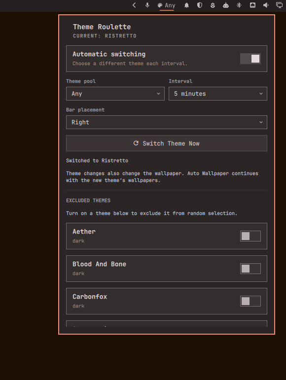
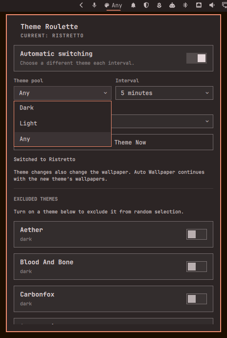
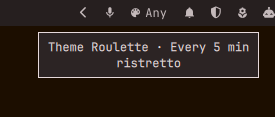
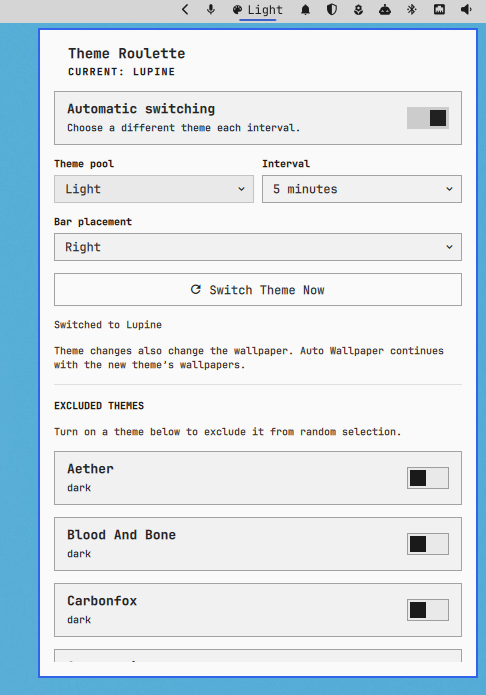

# Theme Roulette

Randomly switch between your installed Omarchy themes, with **Dark / Light / Any** pools, exclusions, and a configurable schedule. A Quickshell bar widget puts the controls one click away.



## Features

- **Enable / Disable** automatic switching without removing the widget.
- **Dark / Light / Any** theme pools.
- Intervals of **5, 15, or 30 minutes; 1, 2, or 4 hours**.
- Exclude individual themes; the current theme is always skipped.
- **Switch Theme Now**, also available by middle-clicking the widget.
- **Left / Centre / Right** bar placement from the controls.
- Dynamic discovery of installed stock and custom themes, including user overlays.
- Native `omarchy theme set` application, preserving normal retinting and hooks.
- One shared schedule across monitors, persistent settings, and overlapping-worker protection.

## Screenshots

Theme pool choices:



Bar tooltip showing the interval and current theme:



Controls with a light theme:



## Requirements

Omarchy **Quattro**, with its Quickshell plugin API and `omarchy plugin` commands. Tested on **Omarchy 4.0.4-1**; older versions and future incompatible API changes are not guaranteed.

Requires Python 3 (standard library only), Omarchy's shell/Qt Quick components, and the installed `omarchy theme color`, `omarchy theme set`, `omarchy bar move`, and `omarchy-theme-colors-from-alacritty` commands. The palette icon uses the shell's Nerd Font. Git is needed by Omarchy's plugin installer. No pip packages, elevated privileges, external services, or network requests are required by the plugin itself.

The implementation uses Omarchy's conventional `~/.config/omarchy` and `~/.local/state/omarchy` locations. Custom XDG config/state directory relocation is not supported.

## Install

```sh
omarchy plugin add https://github.com/c8h10n4o2-b/omarchy-theme-roulette.git --enable
```

Omarchy validates the root manifest and installs into `~/.config/omarchy/plugins/z.theme-roulette/`. The stable plugin ID is **`z.theme-roulette`**. It defaults to the right bar section, with automatic switching **off**, pool **Any**, and interval **30 minutes**.

If this ID is already installed from a local development copy, the installer refuses to overwrite it. Back up that folder before using Omarchy's remove command and installing this repository. Do not run two copies under different IDs.

This is an independent implementation maintained by [c8h10n4o2-b](https://github.com/c8h10n4o2-b), distinct from other plugins named Theme Roulette. Use the repository URL and plugin ID above to identify it.

## Use and configure

Click the palette widget to open its controls; press Escape to close them. Enable **Automatic switching**, choose a pool and interval, and use **Bar placement** to move the widget. Moving closes the panel; reopen it in its new position.

An exclusion toggle that is **on** means that theme is excluded. Reopen the panel or click **Refresh Installed Themes** after installing themes. Each switch also rescans the theme directories. **Switch Theme Now** works with automatic switching off. If no other eligible theme exists, nothing changes and the next automatic attempt waits another interval. Status and errors appear in the panel.

Settings persist in the plugin's layout entry in `~/.config/omarchy/shell.json`, using Omarchy's settings API. Placement uses the native `omarchy bar move` command. The plugin does not edit package-owned files or add cron jobs/system services.

Enabling rotation, changing its interval, changing the active theme, or restarting the shell starts a fresh interval. Failed and empty attempts also rearm the timer; missed changes are not replayed after restart.

Themes are discovered from `$OMARCHY_PATH/themes` (normally `/usr/share/omarchy/themes`) and `~/.config/omarchy/themes`. Omarchy resolves dark/light metadata, including legacy palettes, using temporary copies without modifying the source themes. Unknown modes participate only in **Any**.

Optional commands:

```sh
omarchy-shell z.theme-roulette status
omarchy-shell z.theme-roulette refresh
omarchy-shell z.theme-roulette switchNow
omarchy bar move z.theme-roulette --section center
```

## Wallpaper interaction

**Changing a theme also changes its wallpaper.** Theme Roulette invokes Omarchy's normal theme switch and does not control a wallpaper rotator's schedule.

It has been tested alongside `dizziee.auto-wallpaper`, which refreshes its wallpaper list and resets its countdown on a theme change. A theme interval shorter than the wallpaper interval can prevent that rotator from reaching its next change. Independent theme and wallpaper actions can still coincide; there is no shared lock between the plugins. Other wallpaper tools and hooks retain their own behaviour.

## Update, disable, and uninstall

Update a repository installation:

```sh
omarchy plugin update z.theme-roulette
```

To stop rotation while keeping the control, turn off **Automatic switching**. To disable the whole plugin:

```sh
omarchy plugin disable z.theme-roulette
```

Remove it through Omarchy:

```sh
omarchy plugin remove z.theme-roulette
```

Omarchy unloads the plugin and removes its installed Git checkout. Removal does not restore the previously active theme; choose another theme normally if desired. Do not restore an old copy of your entire shell configuration to uninstall this plugin.

## Validation and development

From a checkout on a compatible Omarchy system:

```sh
omarchy plugin validate .
python3 -B -m unittest discover -s . -p 'test_*.py' -v
```

Tests cover selection pools, exclusions, current-theme avoidance, empty/single-candidate cases, theme overlays and symlinks, metadata precedence, legacy palette conversion, settings lookup, and native command dispatch. The resolver tests require Omarchy's installed commands.

The initial release preserves the installed working QML and Python implementation byte-for-byte. It was also checked with an isolated Quickshell service harness and live service status. Qt 6 `qmllint` reports dynamic host-property/type-metadata diagnostics; it is not a clean lint pass. These diagnostics should be distinguished from live runtime failures.

For runtime diagnosis:

```sh
omarchy-shell z.theme-roulette status
qs log -p "$OMARCHY_PATH/shell" --tail 100
```

## License

[MIT](LICENSE).

## References

- [Omarchy plugin development guide](https://plugins.omarchy.org/develop.html)
- [Marketplace publishing guide](https://plugins.omarchy.org/publish.html)
- [Omarchy shell reference](https://github.com/omacom/omarchy/blob/quattro/docs/omarchy-shell.md)
